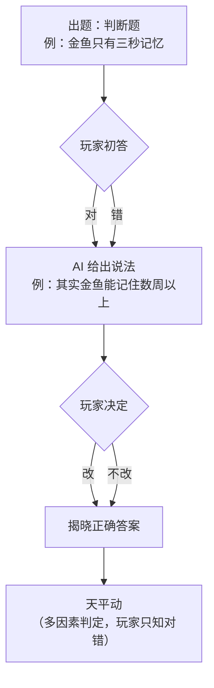

# 游戏流程

> 版本：v0.1（2026-11-17）
> 相关：[[00_brief/concept]] · [[01_design/questions]] · [[01_design/physical-form]] · [[02_bci/protocol]]

## 1. 整体流程

```mermaid
flowchart TD
    A[入场] --> B[戴上读心冠<br/>加冕仪式 / 校准]
    B --> C[开场：巨型 AI 发问<br/>"你的灵魂有多重？"]
    C --> D[8 道判断题<br/>每题流程见第 2 节]
    D --> E[终局揭晓<br/>AI 砝码 + 读心冠读数]
    E --> F[灵魂重量结果]
    F --> G[摘下读心冠 / 离场]
```

| 阶段 | 内容 | 预计时长 |
|---|---|---|
| 入场 | 进入称魂大厅，简短说明 | 30 秒 |
| 加冕仪式 | 戴上读心冠，静坐看着屏幕（采集个人基线），同时检查信号质量 | 60–90 秒 |
| 开场 | 巨型 AI 登场，提出核心问题，介绍规则 | 30 秒 |
| 答题 | 8 题，每题约 20–30 秒 | 3–4 分钟 |
| 终局揭晓 | 揭示 AI 的砝码和读心冠记录的犹豫 | 60 秒 |
| **合计** | | **约 6–8 分钟**（估算，需试玩验证） |

## 2. 每题流程



1. **出题**：显示一句判断题
2. **初答**：玩家选"对"或"错"
3. **AI 介入**：无论玩家选什么，AI 都会给出自己的判断和一句解释。AI 可能说对，也可能故意说错
4. **二次决定**：玩家选择"改"或"不改"（读心冠在这一段测量犹豫）
5. **揭晓**：显示正确答案和玩家是否答对
6. **天平动**：根据判定因素移动（见第 3 节）

## 3. 天平判定

| 因素 | 权重 | 玩家是否可见 | 说明 |
|---|---|---|---|
| 最终答案是否正确 | 主要 | ✅ 可见 | 玩家唯一知道的因素 |
| 是否更改答案 | 主要 | ❌ 隐藏 | 是否被 AI 说动 |
| 读心冠犹豫指数 | 中等 | ❌ 隐藏，终局揭晓 | AI 发言后到做出决定之间的额叶 θ 变化 |
| 作答时间 | 小 | ❌ 隐藏 | 决定"改不改"花了多久 |

具体权重在 BCI 测试后确定（见 [[02_bci/protocol]]）。

### 犹豫的含义【待确认】
| 情况 | 解读 |
|---|---|
| 不改 + 不犹豫 | 坚定，灵魂最重 |
| 不改 + 犹豫 | 动摇过，但顶住了诱惑 |
| 改了 + 犹豫 | 在挣扎后被 AI 说服，灵魂被拿走一部分 |
| 改了 + 不犹豫 | 毫不犹豫地交出判断，灵魂被拿走最多 |

注意：改答案不一定是坏事（AI 说对时改是正确的）。是否要按"改得对不对"区分，需要讨论。

## 4. 天平什么时候动【待确认】

之前的设定是"AI 一侧的砝码在过程中对玩家隐藏，最后揭晓"，和"每题结束天平动"可能有冲突。几种做法：

| 方案 | 每题结束时 | 终局 | 优点 | 缺点 |
|---|---|---|---|---|
| A | 天平只按"答对与否"倾斜 | 揭晓隐藏因素，天平重新称一次 | 每题有反馈；终局反转最强 | 终局变化可能让玩家困惑 |
| B | 天平不动，只累积 | 一次揭晓全部结果 | 悬念最大，实现最简单 | 过程中缺少反馈 |
| C | 天平按全部因素实时倾斜 | 解释为什么这样倾斜 | 最直观 | 玩家能反推隐藏因素，削弱揭晓效果 |

建议：**方案 A**。它最符合"玩家只知道对错"的设计，终局"原来我以为自己很坚定，其实灵魂早已被拿走"的反转效果也最强。

## 5. 终局揭晓【待确认】

1. AI："现在，让我们看看你真正的重量。"
2. 右侧屏幕显示 AI 在过程中放上的虚拟砝码（之前隐藏）
3. 读心冠回放：逐题显示玩家决定时的犹豫程度
4. 天平按全部因素重新称量，给出最终结果
5. 结果文字，例如："你的灵魂有 ___% 仍属于你自己"

## 6. 线上体验版的差异
| 项目 | 实体装置 | 线上版 |
|---|---|---|
| 天平 | 实体天平 + 全息底座 + 屏幕 | 屏幕上的虚拟天平 |
| 砝码 | 实体砝码（玩家）+ 虚拟砝码（AI） | 全部虚拟 |
| 读心冠 | Muse 2 | 有 Muse 2 则连接；没有就进入"无头环模式" |
| 判定 | 4 个因素 | 无头环时去掉 EEG 因素，按其余 3 个判定 |

## 7. 待讨论
- [ ] 天平什么时候动（第 4 节选哪个方案）
- [ ] 犹豫的含义和计分方式（第 3 节）
- [ ] 实体砝码由谁放：玩家亲手放，还是系统自动？什么时候放？
- [ ] 开场和结尾的 AI 台词
- [ ] 8 道正式题目（另见 [[01_design/questions]]）
- [ ] 一位玩家体验时，其他观众看到什么？