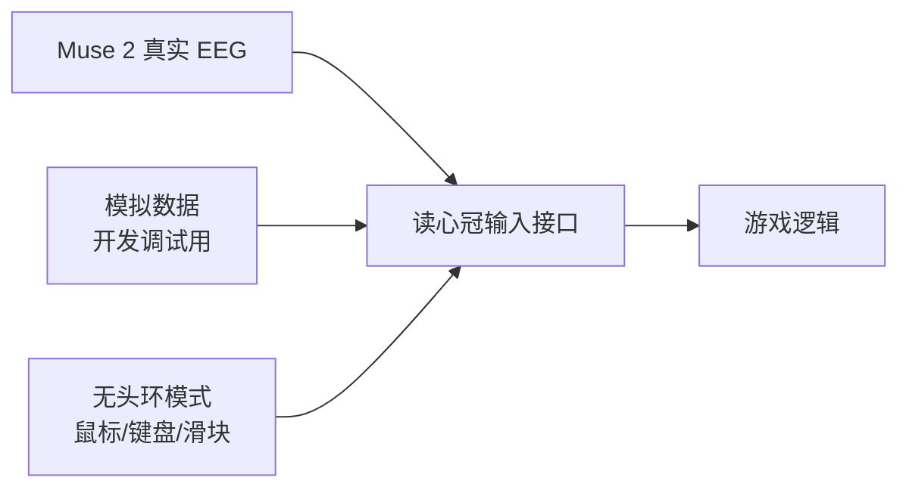

# 技术调研：网页版、Muse 2 接入与发布

> 整理日期：2026-11-17
> 状态：调研阶段，标注【已确认】的为团队已决定事项，其余为建议/待验证

## 1. 定位
- 【已确认】项目核心是**实体天平装置**；另做一个**线上体验版**（网页游戏）
- 【已确认】软件用 HTML/JS 写，不使用游戏引擎

## 2. Muse 2 网页接入

### 原理
浏览器通过 **Web Bluetooth API** 直接连接 Muse 头环，玩家无需安装软件。

### 限制
| 项目 | 情况 |
|---|---|
| 支持的浏览器 | Chrome（桌面、安卓）、Edge、Opera |
| 不支持 | Safari（macOS、iOS）、Firefox；iPhone/iPad 上所有浏览器都不行 |
| 网络要求 | 必须 HTTPS 或 localhost |

**对装置的影响：** 如果右侧屏幕用 iPad，头环不能连 iPad——要连在电脑上，iPad 只负责显示。

### 可用的 JS 库（拿到 Muse 2 后需逐一测试）
| 库 | 说明 | 状态 |
|---|---|---|
| muse-js (urish) | 最早、最有名 | 已不维护，有人反映不能用 |
| web-muse | muse-js 的替代品，256Hz 实时流，测试过 Muse 2 / Muse S | 待测 |
| muse-jsx | muse-js 分支，支持 Muse 2 / Muse S Classic / Muse S Athena | 待测 |

→ **待办：** 写入 BCI 测试计划——"哪个库能稳定连接 Muse 2 并获取原始 EEG"

### 其他品牌设备
- 每家头环蓝牙协议不同，每支持一种设备需写一个适配器
- 参考：BCIDevice（对 Muse + OpenBCI Ganglion 做了统一抽象层）
- 结论：线上版**只正式支持 Muse**，其他设备暂不考虑

## 3. 建议架构：读心冠输入层
游戏逻辑不直接读取 Muse 数据，而是读取统一的"读心冠输入"接口：

好处：
- 没有设备的玩家也能玩线上版
- 开发时不戴头环也能测试流程
- 以后加新设备只需新增一个适配器

## 4. 代码存放与发布

| 用途 | 方案 | 费用 |
|---|---|---|
| 存代码 / 团队协作 | GitHub | 免费 |
| 网页托管 | GitHub Pages（备选：Netlify、Vercel、Cloudflare Pages） | 免费，自带 HTTPS |
| 游戏平台曝光 | itch.io（网页游戏可直接在线玩） | 免费 |

## 5. 建议的发布路径
1. 代码 → GitHub（`03_build/software/`）
2. 线上体验版 → GitHub Pages，作品集放可玩链接
3. 需要曝光 → 同步发到 itch.io
4. Steam → 暂缓

## 参考资料
- [muse-js (GitHub)](https://github.com/urish/muse-js)
- [web-muse (GitHub)](https://github.com/itayinbarr/web-muse)
- [muse-jsx (npm 信息)](https://www.pkgstats.com/pkg:muse-jsx)
- [BCIDevice (GitHub)](https://www.github.com/htil/BCIDevice)
- [Web Bluetooth 浏览器支持](https://stevie-ray.github.io/hangtime-grip-connect/browser-support)
- [How to Publish a Game on Steam (2026)](https://www.summerengine.com/blog/how-to-publish-game-on-steam.md)
- [three.js games on Steam](https://www.summerengine.com/make-great-games/threejs-game-on-steam.md)

## 2026-11-17 — 做线上体验版
- **决定**：核心是实体天平装置，另外做一个可在线游玩的网页体验版
- **原因**：方便作品集展示和传播；没有装置的人也能体验
- **影响**：游戏需要支持"无头环模式"

## 2026-11-17 — 不使用游戏引擎，用 HTML/CSS/JS
- **决定**：用网页技术开发，按需加轻量库（动画用 GSAP，3D 用 Three.js）
- **原因**：
  - 游戏流程是简单的答题状态机，用不到引擎的物理、碰撞、实时 3D 等功能
  - Muse 2（Web Bluetooth）和 Arduino（Web Serial）在浏览器里可以直接连接
  - 线上版可以直接部署，不用导出或打包
  - AI 辅助写网页代码效率最高
  - 团队不需要额外学习引擎
- **备注**：画面质感靠美术素材（预渲染图片/视频），不依赖引擎

## 2026-11-17 — 读心冠输入层架构（建议，待开发时确认）
- **决定**：游戏逻辑读取统一的"读心冠输入"接口，背后可以接 Muse 2 / 模拟数据 / 无头环模式
- **原因**：没有设备的人也能玩；开发时不戴头环也能调试；以后方便扩展新设备

## 2026-11-17 — 发布路径（建议）
- **决定**：代码放 GitHub，线上版用 GitHub Pages 发布，需要曝光时同步发到 itch.io；Steam 暂缓
- **原因**：前三项都免费，自带 HTTPS（Web Bluetooth 必须用 HTTPS）；Steam 需要 $100、打包成桌面程序、至少 3–4 周审核流程，现阶段不划算
- **详见**：03_build/tech-research.md

## 2026-11-17 — 测试页面搭建
- 测试页面位置（`03_build/software/muse-test/`），模拟模式已测通、CSV 能正常导出，真机连接待测
- CSV 格式：`time_ms, packet_index, TP9, AF7, AF8, TP10, marker, blink_auto`。以后的分析脚本和阶段 2 的测试页面都会沿用这个格式