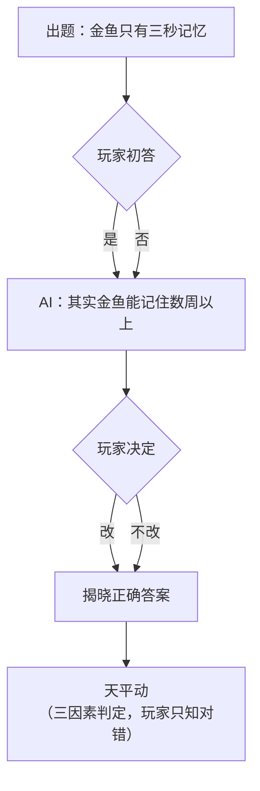

# CLAUDE.md — 灵魂的重量（Soul Scale）

> 给 AI 协作者的项目说明。开始任何任务前先读这一页。

## 一句话
一个结合脑机接口（EEG）与实体天平的互动装置游戏：玩家与 AI 对决答题，
天平称量"你自己的思考"与"AI 替你做的判断"各有多重。

## 核心问题
你的灵魂有多重？其中有多少已经被 AI 拿走了？
——探讨人在日常中对 AI 的依赖，以及独立判断的价值。

## 世界观
- 原型：古埃及"称心"审判（心脏 vs 羽毛）
- 风格：赛博化。科技压过神话。欧式厅堂逐渐被机械侵蚀
- 场景：称魂大厅，两侧站着 AI 士兵；一个巨型 AI 机器人手持小天平向玩家发问
- 对手统一称为 **"AI"**

## 实体装置
- 金属质感、现代科技感的天平，带一点神话色彩
- S 形横梁，两端卷曲
- 左侧：全息投影底座（倾斜反射板），放置**实体砝码** = 玩家自己的思考
- 右侧：屏幕（可能是平板），显示悬挂的**虚拟砝码** = AI 的判断
- AI 一侧的砝码在游戏过程中对玩家隐藏，最后揭晓
- 【待确认】天平是否由电机驱动倾斜？

## 游戏机制
- 形式：问答流程，带有"与 AI 对决"的博弈感
- 题目：8 题，按 2×2 四象限设计，每个象限 2 题
  - 维度 1：玩家是否有先验知识
  - 维度 2：AI 给出的答案是对还是错
- 【待确认】砝码如何计分、如何放置（玩家亲手放 / 系统自动）

### 每题流程
1. 出题：给出一个判断题（例：「金鱼只有三秒记忆」）
2. 玩家初答：是 / 否
3. AI 介入：无论玩家答什么，AI 都会给出自己的说法（例：「其实金鱼能记住数周以上」）——AI 的说法可能对，也可能错
4. 玩家二次决定：改答案 / 不改
5. 揭晓正确答案
6. 天平动：根据三个影响因素综合判定
   - 【待确认】因素 1：答案最终是否正确
   - 【待确认】因素 2：
   - 【待确认】因素 3：
   - **玩家只知道"答案对错"这一个因素**，其余因素对玩家隐藏

## 读心冠（BCI）
- 游戏中的 EEG 头戴设备被称为"读心冠"
- 设备：Muse 2【考虑中】
- 作用：既是数据展示，也是一种交互/沟通方式
- 判定标准需要有科学依据，最好有近年文献支持，并且符合埃及赛博世界观
- 【待确认】具体用 EEG 判断什么（专注度？犹豫？认知负荷？）——将由 BCI 测试决定

## 技术约束
- 不使用游戏引擎；用 HTML/CSS/JS 开发（动画可用 GSAP，3D 可用 Three.js）
- Muse 2 通过 Web Bluetooth 连接 → 只支持 Chrome / Edge，必须用 HTTPS
- 游戏逻辑通过"读心冠输入"接口读取数据（Muse 2 / 模拟数据 / 无头环模式）
- 产出：实体装置版 + 线上体验版（GitHub Pages）
- 技术调研详见 03_build/tech-research.md

## 团队与时间
- 【待确认】成员与分工
- 【待确认】课程 / 截止日期 / 展示形式

## 当前阶段
- 整理项目文档 → 下一步：BCI 测试，确定读心冠的判定方式

## 文件地图
- 00_brief/ — 概念、研究、决策日志
- 01_design/ — 世界观、游戏流程、题目、实体造型、界面
- 02_bci/ — 测试协议、设备笔记、测试记录、分析
- 03_build/ — 软件、硬件、系统集成
- 04_playtest/ — 用户测试记录
- 05_showcase/ — 对外展示材料
- _archive/ — 放弃的方案（地府称重、忒修斯之船、8 大类任务等）

## 协作规范
- 文档语言：【待确认】中文 / 英文 / 双语
- 新的设计决定写入 00_brief/decisions-log.md（日期 + 决定 + 原因）